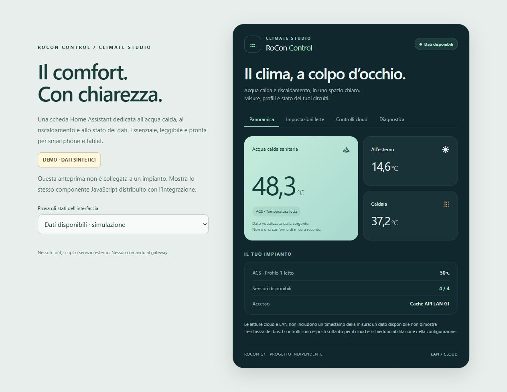

# Daikin RoCon Control per Home Assistant

Integrazione indipendente per **DAIKIN Control / ROTEX RoCon G1**, con accesso
cloud e un percorso LAN sperimentale separato. Non usa ONECTA.

**Versione sperimentale 0.5.0.** Letture e programmi cloud verificati anche in Home Assistant;
controlli implementati e testati con risposte simulate. La scrittura sul gateway
reale e la compatibilità tra firmware devono ancora essere verificate.
Non installa automazioni né modifica setpoint durante l'installazione.

La versione 0.5.0 aggiunge **RoCon Studio**: programmi settimanali facili, solare,
consumi e storico in una sola scheda, con tre palette selezionabili. I giorni
selezionati e i profili si salvano con una sola richiesta, protetta da modifiche concorrenti.
[Installazione visuale, template e demo](docs/STUDIO.md).
Resta inclusa la gestione dei circuiti con nome vuoto introdotta nella 0.4.1.

## Cosa espone il cloud

| Funzione | Entità Home Assistant | Limite |
| --- | --- | --- |
| Temperature e codici esposti | sensor | Campi mancanti indisponibili, nessuno zero sostitutivo |
| Tre profili per circuito | number | ACS 10–70 °C, riscaldamento 5–40 °C, passo 0,5: range dell'app |
| Ridotta e assenza | number | Solo circuiti riscaldamento |
| Modalità condivisa | select | Standby, heating, reduced, summer, automatic_1/2, cooling se esposto |
| Boost ACS una tantum | switch | Solo circuito water |
| Party | number | 0–360 minuti, passo 15; non ore |
| Vacanze | text | Coppia ISO inizio/fine inclusiva, sul circuito riscaldamento |
| Due programmi, sette giorni | text | Tre fasce al giorno, passo 15 minuti, fine 24:00 |
| Nome circuito | text | Metadato opzionale, entità disabilitata di default |
| Stato comando | sensor + attributi | Richiesto, confermato, in attesa o incerto distinti |

Le modalità, Party e vacanze possono influenzare insieme riscaldamento e ACS.
Non esiste un setpoint attivo ricavabile scegliendo arbitrariamente il profilo 1.
Curva climatica, isteresi, disinfezione, parametri installatore e comando pompe/
valvole non sono setter verificati dell'app e non vengono inventati.

## Interfaccia Climate Studio



Scheda Lovelace responsive, senza librerie o servizi esterni: Panoramica,
Impostazioni lette, Controlli cloud e Diagnostica. Riconosce i sensori tramite
attributi; non contiene indirizzi, credenziali o entity_id di una casa.
L'editor consente anche di selezionare sensori esistenti per la sola visualizzazione.
La demo HTML usa dati sintetici e non è connessa a un impianto.

## Installazione

Repository personalizzato HACS, categoria **Integration**:
`https://github.com/MarlonMarketing/daikin-rocon-control`.

Leggere [installazione e configurazione](docs/INSTALLAZIONE.md) e
[controlli cloud e loro limiti](docs/CLOUD_CONTROL.md).
Selezionare Cloud nel flusso UI, inserire le credenziali della app e scegliere
l'impianto scoperto nell'account. Le credenziali restano nella config entry privata
HA: proteggere storage e backup. Nessuna API key LAN richiesta per il cloud.

Le scritture sono abilitate esplicitamente nella configurazione. Ogni comando
rilegge il circuito, verifica appartenenza, disponibilità e formato, poi invia
un solo PUT. Nessun retry di scritture e nessun aggiornamento ottimistico.
Un timeout mantiene l'esito incerto e blocca altre scritture finché non viene
osservata una conferma coerente. HTTP 200 non è conferma fisica.

La lettura LAN è opzionale, in sola lettura e richiede una API key G1 già valida.
Non crea utenti o chiavi e non tenta credenziali predefinite.

## Diagnostica e sviluppo

Il client diagnostico originale resta separato e in sola lettura, richiede
Python 3.11+ e la sola libreria standard:

```console
python -m unittest discover -s tests -v
python -m rocon_local.cli --help
python -m rocon_local.cli cloud --output _private/session.json
```

Su Windows è disponibile `Diagnostica-cloud.cmd`. Inserimento password nascosto;
non passare segreti nella riga di comando. I test offline usano dati sintetici.
GitHub Actions include anche runtime HA con cloud simulato, hassfest e HACS:
controllarne l'esito in Actions prima di installare una versione.

Documentazione: [protocollo](docs/PROTOCOLLO.md), [ricerca G1](docs/FIRMWARE_G1.md),
[accesso LAN](docs/ACCESSO_LAN.md), [foto sanificate](docs/FOTO_HARDWARE.md),
[piano di test](docs/PIANO_TEST.md).

Il repository distribuisce soltanto codice originale, documentazione e immagini
revisionate. Non include APK, firmware, decompilati, inventari, snapshot account,
credenziali, indirizzi dell'impianto o materiali della cartella `_private/`.
`tools/build_public.py` prepara un archivio da una allowlist revisionabile.

Progetto indipendente da Daikin/ROTEX. Specifiche ricostruite, API non ufficiale.
Licenza MIT per il materiale originale. Home Assistant funziona senza REA o AI.
