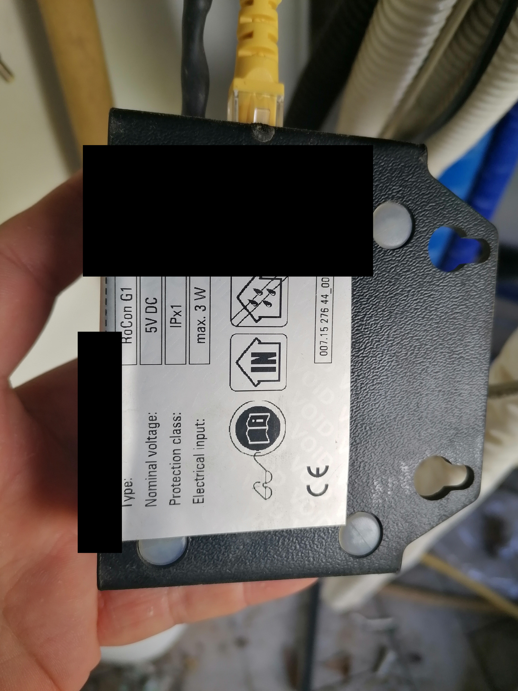
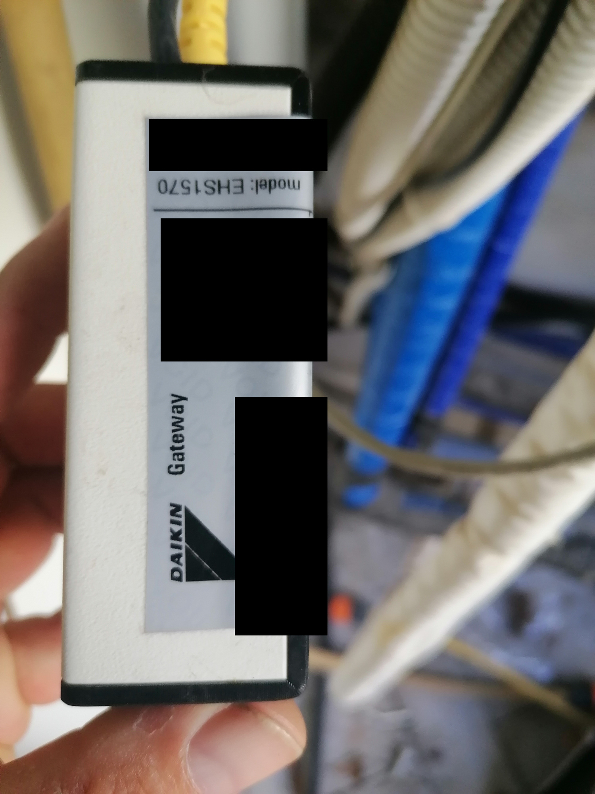
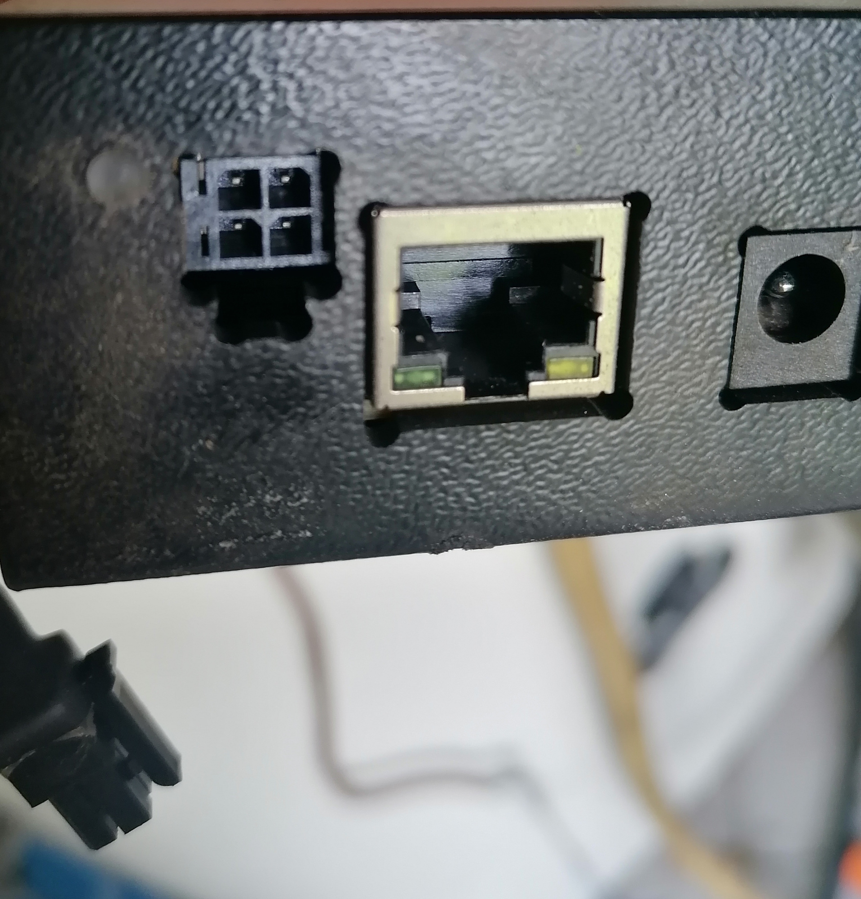
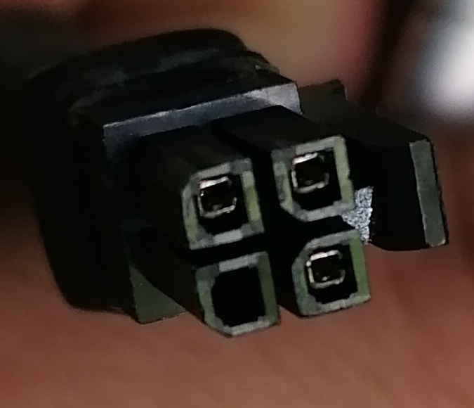
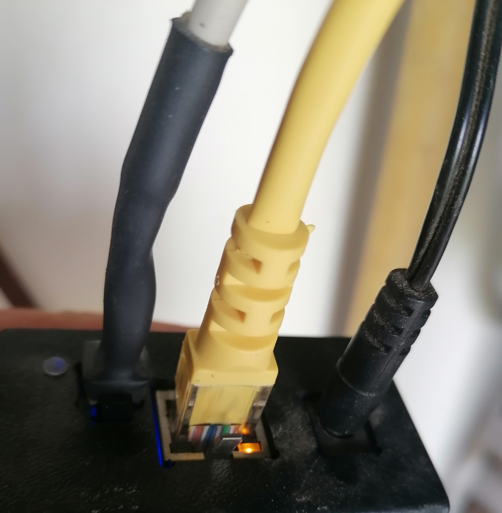

# Foto hardware selezionate e sanificate

Cinque copie destinate alla documentazione tecnica del progetto. Due foto
ridondanti non sono state copiate nella cartella di lavoro. La foto dello schema
del manuale è conservata soltanto come riferimento privato, con metadati rimossi.

Le foto sono state elaborate localmente, su autorizzazione del proprietario,
senza generazione AI: maschere nere opache, ritagli e nuova codifica dai pixel.
Seriale, asset number/MAC, QR e codici a barre visibili sono stati coperti o
esclusi dall'inquadratura. EXIF, GPS, XMP, commenti e profili incorporati sono
stati rimossi dalle copie. Gli originali esterni al progetto restano invariati.
La verifica visiva e quella dei metadati riguardano queste specifiche copie.

## Etichetta tecnica

Sono leggibili il tipo RoCon G1, alimentazione nominale 5 V DC, IPx1 e assorbimento
massimo 3 W. Gli identificativi univoci e il barcode sono oscurati, inclusa
la porzione di etichetta visibile sul bordo.

## Etichetta del modello

Il nome commerciale e il codice modello generico restano utilizzabili per
l'identificazione tecnica; i dati univoci non vengono riportati nel testo.

## Porte e connettore esterno

Le foto mostrano porta RJ45, presa di alimentazione e connettore a quattro
posizioni. Nella spina fotografata si distinguono tre contatti metallici.
Forma e numero di contatti non stabiliscono l'assegnazione dei pin o le tensioni:
non usarli come schema di collegamento senza verifica documentale/elettrica.

## Cablaggio esterno

La zona dell'etichetta inferiore con dati univoci è esclusa dal ritaglio.
Le foto documentano soltanto la configurazione visibile al momento dello scatto;
non provano lo stato attuale della connessione cloud, del servizio web o del bus.

## Schema del manuale, riferimento privato

La pagina fotografata mostra un collegamento CAN con riferimenti RoCon BE2/J13,
RoCon M1 e RoCon U1 nel documento. Non contiene identificativi personali visibili,
ma non dimostra che quel pinout sia quello della HPSU/controller installati.
Non è inclusa nella galleria o nell'archivio pubblico delle foto.

Impronte SHA-256 e dimensioni delle copie pubbliche sono elencate in
[manifest.json](images/hardware/manifest.json). Piano delle maschere e audit
degli originali restano nella sezione privata del progetto.
