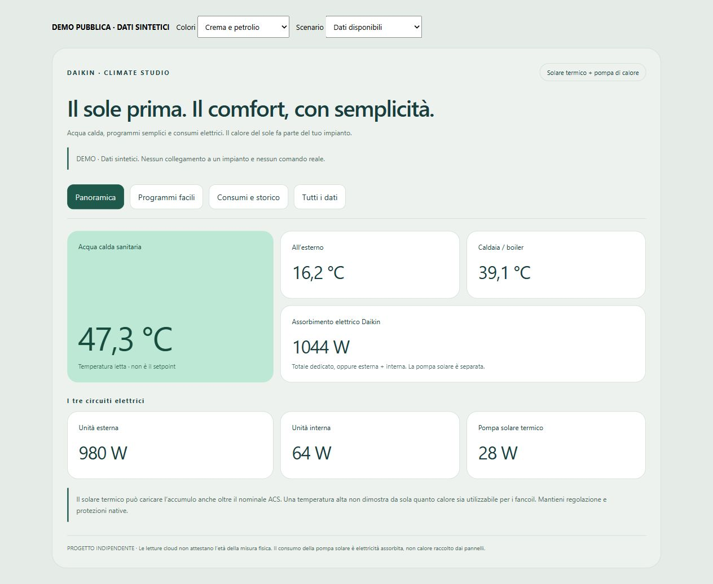

# RoCon Studio: programmi facili, solare e consumi

Incluso dalla versione 0.5.0, senza librerie grafiche esterne e senza account aggiuntivi.
La scheda funziona in Home Assistant anche a PC e strumenti di sviluppo spenti.

## Installazione semplice

1. Installare o aggiornare **RoCon Daikin Control** da questo repository tramite HACS,
   categoria Integration. Caricare la nuova versione seguendo la richiesta di riavvio di HA.
2. Configurare il proprio account cloud nell'integrazione, abilitando i controlli soltanto
   se desiderati. Nessuna credenziale va copiata nella configurazione della scheda.
3. Dashboard → menu → Risorse: aggiungere **JavaScript module**
   `/rocon_g1_local/rocon-studio-card.js?v=0.5.0`.
4. Modificare la dashboard → Aggiungi scheda → **RoCon Studio · programmi e consumi**.
   Nell'editor visuale scegliere i tre sensori elettrici: unità esterna, interna e pompa solare.
5. Scegliere colori **Solare · crema e petrolio**, **Petrolio · scuro e menta** oppure
   **Tema Home Assistant**. Eventuali sensori storici aggiuntivi si scelgono con i selettori.

La configurazione minima è anche disponibile in [studio-card.json](studio-card.json):

```json
{"type":"custom:rocon-studio-card","theme":"solar"}
```

Non contiene entity_id domestici. I sensori cloud vengono rilevati dai loro attributi;
in presenza di più gateway o circuiti bisogna selezionare quelli desiderati nell'editor.
I misuratori elettrici non sono individuabili in modo universale: sceglierli una sola
volta con i selettori, senza scrivere identificativi a mano.

Per la sola visualizzazione senza integrazione, copiare
`custom_components/rocon_g1_local/frontend/rocon-studio-card.js` in
`/config/www/rocon-studio-card.js` e usare la risorsa `/local/rocon-studio-card.js?v=0.5.0`.
La scheda funziona con sensori selezionati nell'editor; i comandi richiedono invece
l'integrazione cloud originale e il suo servizio, non un semplice sensore rinominato.

## Cosa contiene



[Anteprima della palette petrolio e menta](images/studio-night-demo.png).

- **Panoramica**: temperature, potenza Daikin e tre circuiti elettrici separati.
- **Programmi facili**: tutti i giorni, feriali, weekend o singolo giorno; tre fasce
  con inizio, fine, attivazione e temperatura. Supporta fine alle 24:00 e quarti d'ora.
- **Consumi e storico**: potenza in W/kW, storico temperature e una stima giornaliera
  in kWh dalle medie orarie di potenza del recorder.
- **Tutti i dati**: letture e gruppi storici aggiuntivi, compresi sensori oggi non disponibili.
- **Più tempo al caldo**: Party in ore comprensibili, con riepilogo prima della richiesta.

Le tre temperature sono condivise tra giorni e programmi: il controller non offre
una temperatura indipendente per ogni giorno di ogni fascia. La scheda lo indica.
Le entità dei programmi sono abilitate per impostazione predefinita nelle nuove
installazioni. Se già disabilitate nel registro HA, abilitarle dalle impostazioni entità.

## Salvataggio degli orari

“Rivedi modifiche” mostra giorni, differenze e profili globali prima dell'invio.
“Invia questa configurazione” effettua **un solo PUT sul circuito**, comprendendo
i giorni selezionati e le temperature. Non commuta automaticamente il modo operativo.
I valori già cambiati dall'app o dal controller bloccano il salvataggio se diversi
dalla fotografia su cui è basata la modifica. Rileggere i dati prima di riprovare.

Richiesto, confermato dal cloud e incerto sono stati distinti. Nessuna scrittura viene
ritentata automaticamente. La conferma cloud non sostituisce una prova sul proprio
controller. Per il circuito ACS non selezionare un programma vuoto pensando che sia
una modalità di risparmio. I nominali ridotta/assenza devono essere coerenti.

Il servizio HA `rocon_g1_local.set_schedule` accetta un'entità testo Programma
originale, `program` (1 o 2), `days` (giorni inglesi → tre fasce serializzate),
`profiles` opzionale (tre valori condivisi), `expected` opzionale per il controllo
di concorrenza. La scheda prepara il formato: l'utente non deve scriverlo.

## Energia, storico e solare

Non chiamare kWh una misura in W. La scheda converte W/kW solo se l'unità è corretta,
non duplica il totale insieme ai suoi componenti e rifiuta due misuratori uguali.
Se si sceglie un totale dedicato, questo sostituisce la somma esterna + interna.
La pompa solare resta separata. La stima dalle medie orarie considera soltanto
intervalli coperti da tutti i misuratori del totale; riporta le ore presenti.
Non è un contatore fiscale, non colma lacune con zero e non misura COP o calore solare.

Il contributo termico dei pannelli può aumentare la temperatura dell'accumulo
indipendentemente dal setpoint della PDC. La scheda non comanda la centralina
drain-back e non cambia parametri installatore, protezioni, inverter o batteria.
Se esistono già sensori storici, selezionarli senza sostituirli o rinominarli:
una nuova scheda non cancella il recorder.

## Demo e template pubblici

- [Studio completo](studio-preview.html): stesso componente della dashboard, dati sintetici.
- [Configuratore autonomo](configurazione-semplice.html): prototipo locale da esplorare,
  privo di collegamenti HA o comandi. Non è un secondo pannello autenticato.

Scaricare il repository e aprire le demo con un server statico locale, ad esempio
`python -m http.server 8080` dalla cartella principale. Questi file non sono un
servizio cloud né un sito di login. Non pubblicare i propri snapshot nella cartella demo.

La versione sperimentale è verificata con risposte simulate e controlli del runtime HA.
Le nuove scritture settimanali non sono dichiarate collaudate su tutti i firmware.
